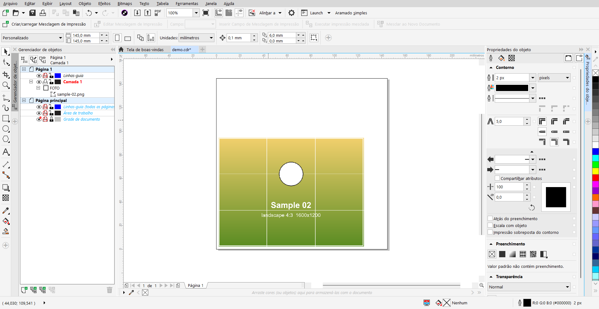
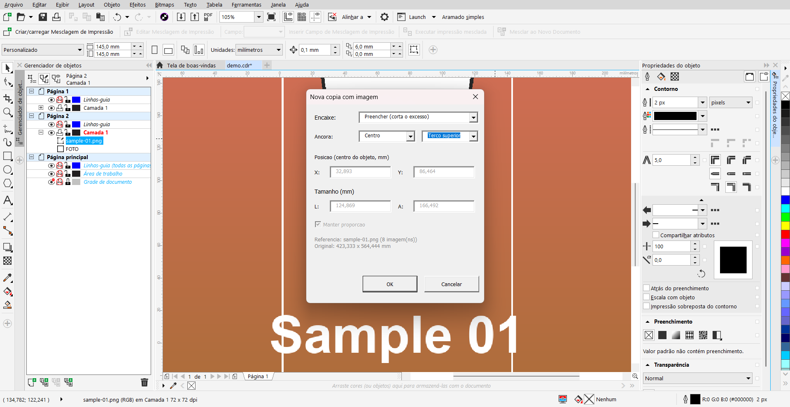
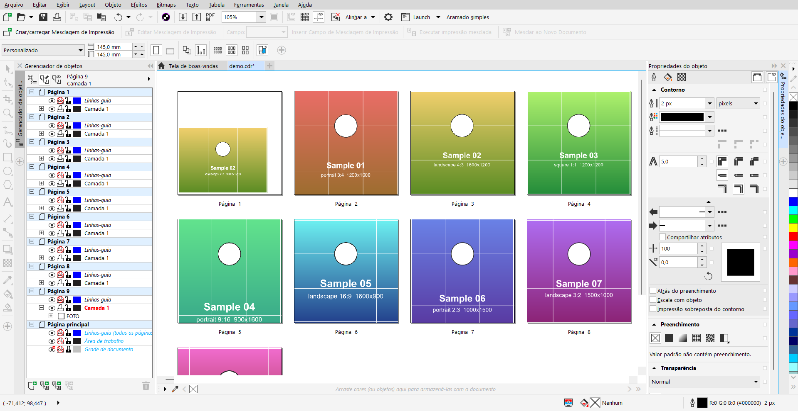

**English** | [Português](README.pt-BR.md)

# Corel Template

A CorelDRAW macro that turns page 1 into a template and creates one new page per image, with each image placed inside a PowerClip frame, so you can lay out cards, badges or certificates in batch without touching the original.

## Setup in 5 minutes

1. CorelDRAW 2018 or later with VBA installed. Press `Alt+F11`: if the VBA editor opens, you are set. If not, re-run the CorelDRAW installer > Modify > Utilities > *Visual Basic for Applications*.
2. In the VBA editor, select **GlobalMacros** and use **File > Import File** to import `modTemplate.bas`.
3. **Insert > UserForm**. In the Properties window (F4), rename it to `frmTemplate`.
4. Open the form's code window, make sure it is **completely empty** (Ctrl+A, Delete), and paste the whole content of `frmTemplate-codigo.txt`.
5. Optional: at the top of `modTemplate`, set `LANG = "pt"` for Portuguese and change `FRAME_NAME` if your frame has another name. Then **Debug > Compile GlobalMacros** and save (Ctrl+S).

To use it: on page 1 of your document, name the frame object `FOTO` in the Object Manager (optionally put an example image inside it), then run **Tools > Macros > Run Macro > NovaCopiaComImagem**, pick the images and choose the fit mode.

To try it right away, use the 8 test images in [`samples/`](samples): different aspect ratios, a rule-of-thirds grid and a circle on the upper third, so you can see exactly where each fit mode and anchor crops.

## Fit modes

| Mode | What it does |
|---|---|
| **Fill** (default) | Scales the image to cover the whole frame without distortion; the excess is cropped. |
| **Fit** | The whole image fits inside the frame; margins are left. |
| **Same as example image** | Uses the position and size of the example image placed in the frame on page 1. |
| **Manual** | X, Y, width and height typed in the dialog, in the same coordinates as CorelDRAW's property bar. |

Fill and Fit use an **anchor**: horizontal (left, centre, right) and vertical (top, upper third, centre, bottom). *Upper third* keeps faces in portrait photos instead of cropping through the middle.

## How it works

- `modTemplate.bas`: the macro. It copies page 1 layer by layer to a new page (shapes copied bottom-up to keep stacking order), imports the image, scales and positions it, and puts it in the frame with `AddToPowerClip` without re-centring.
- `frmTemplate-codigo.txt`: a dialog built at runtime with `Controls.Add`, so it can be installed by pasting text (no binary `.frx` file).
- Multi-select file picker via the Windows API (`GetOpenFileName`), 32/64-bit safe.
- The whole run is one undo step (`BeginCommandGroup`); the last values used are remembered in the registry (`SaveSetting`).

## Technical decisions & what I learned

- **Text-only install.** UserForms normally need a binary `.frx`; creating the controls in code keeps the project diffable in git and easy to paste.
- **Coordinates match the property bar** (millimetres, page origin, object centre), so numbers read on screen can be typed straight into the dialog.
- **An example image as the ruler** beat typing numbers: positioning one image by hand and copying its geometry removed every "photo in the wrong place" error during testing.
- VBA pitfalls met on the way: `.bas` files must have CRLF line endings, and the `Attribute VB_Name` line breaks the code if pasted instead of imported.

## Known limitations

- Tested only on CorelDRAW 2018 (20.1), Windows, Portuguese UI.
- Fill/Fit use the frame's bounding box; for non-rectangular frames the PowerClip does the final shape cut.
- Only page 1 can be the template. Master-page layers are not copied (they already show on every page).
- File names with characters outside the Windows ANSI code page may fail in the file picker.

## License

[MIT](LICENSE)
