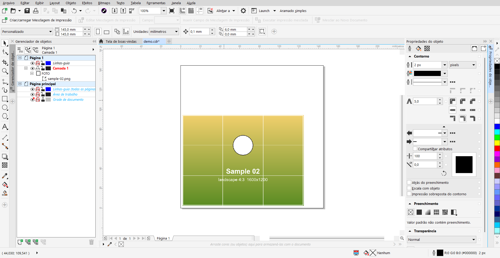
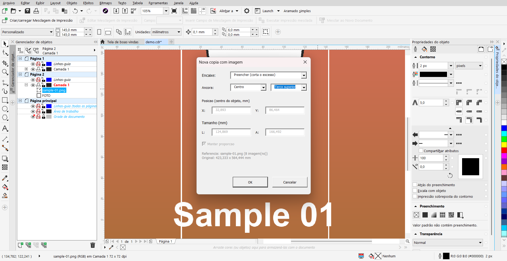
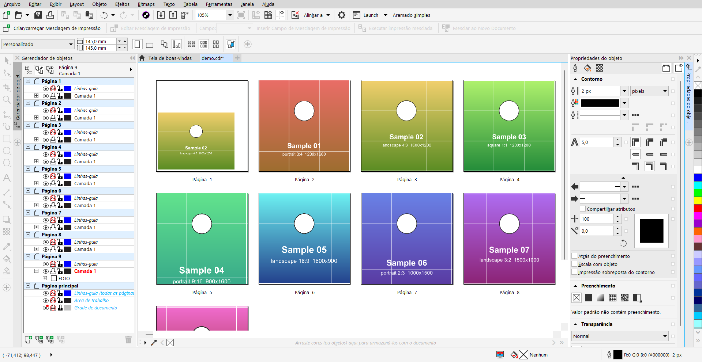

[English](README.md) | **Português**

# Corel Template

Macro para CorelDRAW que transforma a página 1 em modelo e cria uma página nova por imagem, com cada imagem dentro de uma moldura PowerClip. Serve para montar cartões, crachás ou certificados em lote sem mexer no original.

## Instalação em 5 minutos

1. CorelDRAW 2018 ou mais novo, com VBA instalado. Aperte `Alt+F11`: se o editor do VBA abrir, está pronto. Se não abrir, rode o instalador do CorelDRAW > Modificar > Utilitários > *Visual Basic for Applications*.
2. No editor do VBA, clique em **GlobalMacros** e use **Arquivo > Importar arquivo** para importar `modTemplate.bas`.
3. **Inserir > UserForm**. Na janela Propriedades (F4), troque o nome para `frmTemplate`.
4. Abra o código do form, deixe a janela **totalmente vazia** (Ctrl+A, Delete) e cole o conteúdo inteiro de `frmTemplate-codigo.txt`.
5. No topo do `modTemplate`, troque `LANG = "en"` por `LANG = "pt"` para a caixa em português, e mude `FRAME_NAME` se a sua moldura tiver outro nome. Depois **Depurar > Compilar GlobalMacros** e salve (Ctrl+S).

> Se colar o `modTemplate.bas` em vez de importar, não cole a primeira linha (`Attribute VB_Name = ...`): ela só vale em arquivo importado.

Para usar: na página 1 do documento, dê o nome `FOTO` à moldura no Gerenciador de objetos (se quiser, ponha uma imagem de exemplo dentro dela) e rode **Ferramentas > Macros > Executar macro > NovaCopiaComImagem**. Escolha as imagens e o modo de encaixe.

Para testar na hora, use as 8 imagens de teste em [`samples/`](samples): proporções diferentes, grade de terços e um círculo no terço superior, para ver exatamente onde cada modo de encaixe e cada âncora corta.

## Modos de encaixe

| Modo | O que faz |
|---|---|
| **Preencher** (padrão) | Escala a imagem até cobrir a moldura inteira, sem distorcer; o excesso é cortado. |
| **Caber** | A imagem inteira cabe na moldura; sobra margem. |
| **Igual à imagem de exemplo** | Usa a posição e o tamanho da imagem de exemplo colocada na moldura da página 1. |
| **Manual** | X, Y, largura e altura digitados na caixa, nas mesmas coordenadas da barra de propriedades. |

Preencher e Caber usam uma **âncora**: horizontal (esquerda, centro, direita) e vertical (topo, terço superior, centro, base). *Terço superior* preserva o rosto em foto em pé, em vez de cortar pelo meio.

## Como funciona

- `modTemplate.bas`: a macro. Copia a página 1 camada por camada para uma página nova (de baixo para cima, para manter a ordem), importa a imagem, escala, posiciona e coloca na moldura com `AddToPowerClip` sem recentralizar.
- `frmTemplate-codigo.txt`: caixa montada em tempo de execução com `Controls.Add`, para instalar colando texto (sem arquivo binário `.frx`).
- Janela de arquivos com seleção múltipla pela API do Windows (`GetOpenFileName`), compatível com 32 e 64 bits.
- A execução inteira é um passo de desfazer (`BeginCommandGroup`); os últimos valores usados ficam salvos no registro (`SaveSetting`).

## Decisões técnicas e o que aprendi

- **Instalação só com texto.** UserForm normalmente precisa de um `.frx` binário; criar os controles por código deixa o projeto legível no git e fácil de colar.
- **Coordenadas iguais à barra de propriedades** (milímetros, origem da página, centro do objeto): o número lido na tela vai direto para a caixa.
- **Imagem de exemplo como régua** foi melhor que digitar números: posicionar uma imagem à mão e copiar a geometria acabou com o "foto no lugar errado" dos testes.
- Armadilhas do VBA no caminho: `.bas` precisa de quebra de linha CRLF, e a linha `Attribute VB_Name` quebra o código se for colada em vez de importada.

## Limitações conhecidas

- Testado só no CorelDRAW 2018 (20.1), Windows, interface em português.
- Preencher/Caber usam o retângulo envolvente da moldura; em moldura não retangular, o PowerClip faz o recorte final.
- Só a página 1 pode ser o modelo. Camadas da página principal não são copiadas (já aparecem em todas as páginas).
- Nome de arquivo com caracteres fora da página de código ANSI do Windows pode falhar na janela de arquivos.

## Licença

[MIT](LICENSE)
